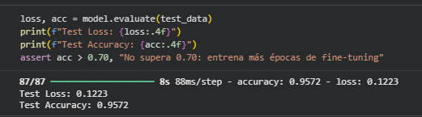
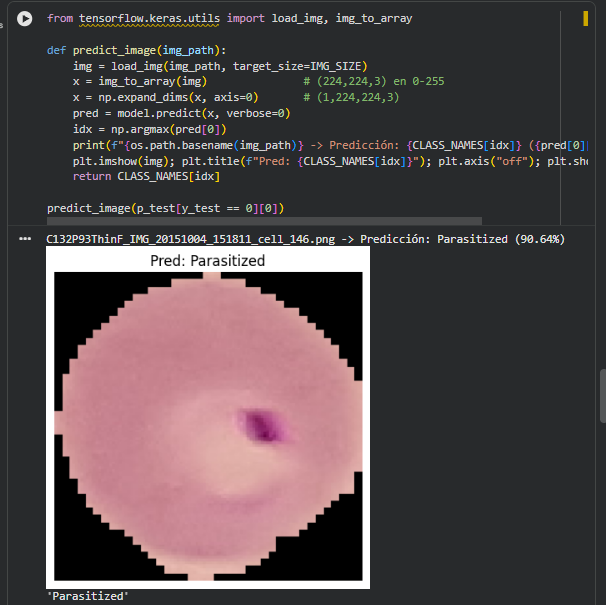
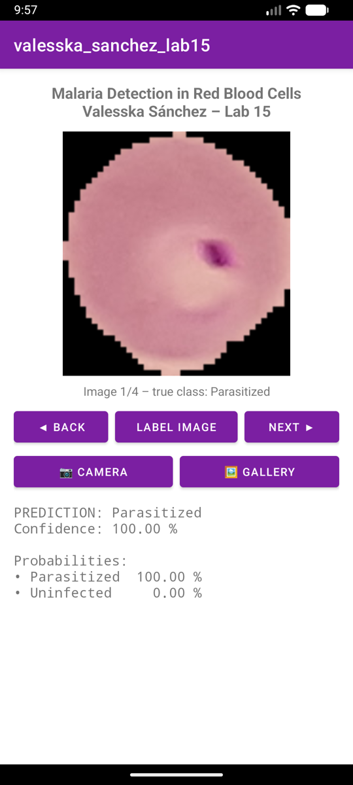
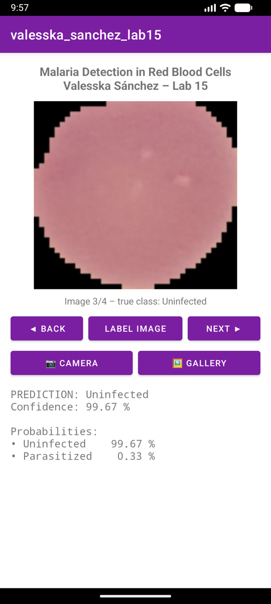

# valesska_sanchez_lab15 – Malaria Detection in Red Blood Cells

Android app (Kotlin) that classifies Giemsa-stained red blood cell images as **Parasitized** (infected with *Plasmodium*) or **Uninfected**, using a custom TensorFlow Lite model with **ML Kit Custom Image Labeling**.

Workshop: *Mobile application for the recognition of medical images* (Lab 15) – Valesska Sánchez.

## Model (Google Colab)

- **Notebook:** [`valesska_sanchez_lab15.ipynb`](valesska_sanchez_lab15.ipynb)
- **Dataset:** NIH / National Library of Medicine *Malaria Cell Images* (27,558 images, 2 classes), split 80 / 10 / 10 into train / validation / test.
- **Architecture:** MobileNetV2 (ImageNet weights), transfer learning + fine-tuning, input 224 × 224.
- **Test accuracy:** **0.9572** with `model.evaluate(test_data)` (required: > 0.70).
- **Export:** `blood_cells_model.tflite` with metadata (labels), loaded from `app/src/main/assets/`.

> The app uses the `.tflite` exported by this notebook run. In Colab, `load_img` resizes with nearest-neighbour interpolation, while ML Kit on Android resizes more smoothly, so a borderline image can get a different label: `cell_parasitized_2.png` is *Uninfected* in Colab but *Parasitized* (63.5 %) in the app.

| Test accuracy | Single-image prediction (`np.expand_dims` + `np.argmax`) |
|---|---|
|  |  |

## Android app

| Parasitized | Uninfected |
|---|---|
|  |  |

- **◀ Back / Next ▶ / Label Image:** the 4 test images (2 per class, from the test set) in `res/drawable`. All 4 are classified correctly in the app.
- **📷 Camera:** takes a photo with the phone camera and classifies it.
- **🖼 Gallery:** picks an image with the Android photo picker (no permissions needed) and classifies it.

Main files:

- `app/src/main/java/com/example/valesska_sanchez_lab15/MainActivity.kt`
- `app/src/main/res/layout/activity_main.xml`
- `app/src/main/assets/blood_cells_model.tflite`
- `app/build.gradle.kts` (`com.google.mlkit:image-labeling-custom:17.0.3`, `androidResources { noCompress += "tflite" }`)

## Run

Open the folder in Android Studio, let Gradle sync, and press **Run** on an emulator or an Android phone (minSdk 24).

## Limitations

The model only knows two classes, so any photo receives one of them. Reliable results need an image of a single stained red blood cell seen under a microscope. This is an educational project, not a medical diagnostic tool.
